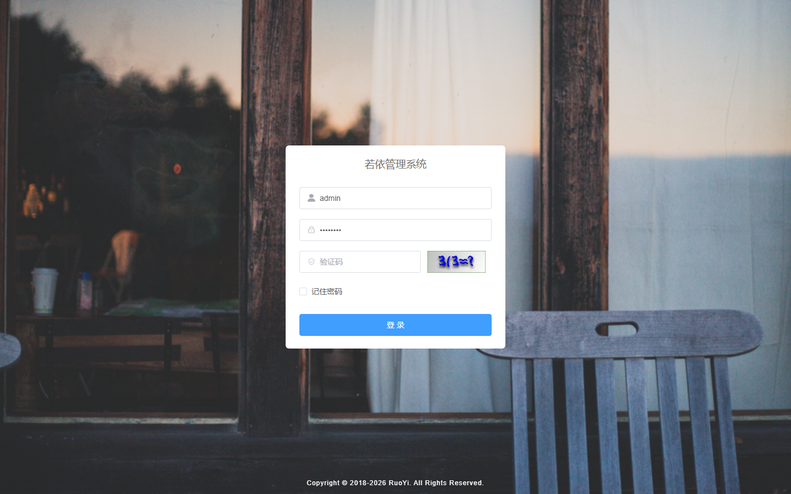
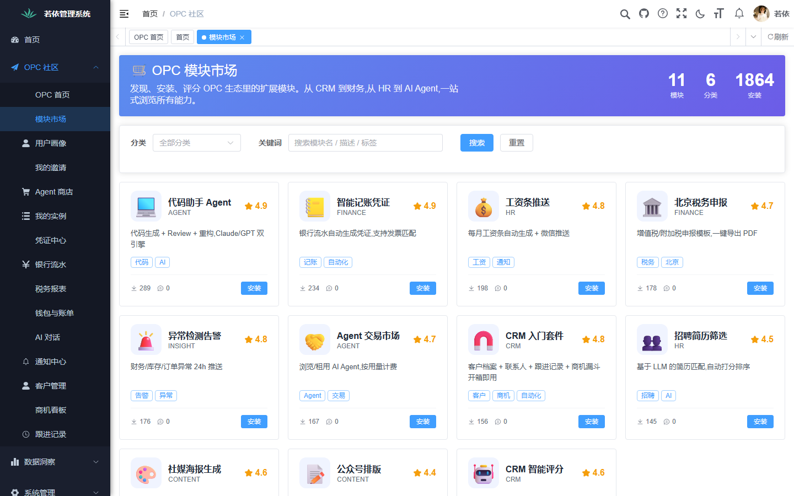
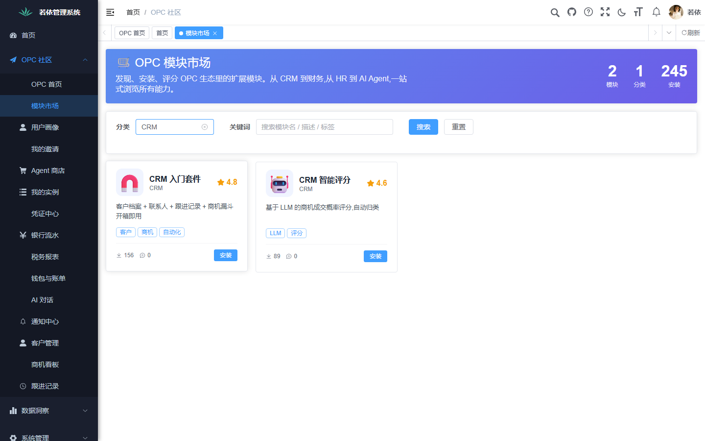
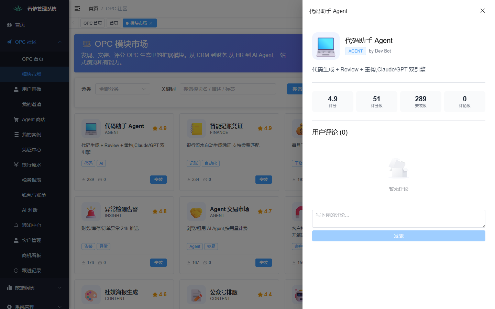

# OPC (一人公司 + N 个数字员工)

> 一站式智能财务 SaaS。基于 RuoYi Cloud Spring Boot 3 + Vue 3 + TypeScript（OPC 扩展），让"一人公司"以**自然语言**驱动 7×24 的 AI 数字员工团队完成记账、报税、对账、报销、风控。

[](./OPC-W1-TASK-BREAKDOWN.md)
[](./OPC-SECURITY-REPORT-v0.1.md)

---

## 这是什么

OPC = **One-Person Company**，核心假设是未来大量"一人公司"会涌现，
而创办者不可能同时是财务、人事、销售、运营专家。我们提供 **"老板 + N 个 AI 数字员工"**
的模式，把财务记账、税务申报、客户管理、文档处理等环节交给训练有素 + 受严格内控约束的 AI。

### 业务场景（来自 `init.md` §业务场景）

| # | 场景 | 对应 Agent |
|---|------|-----------|
| 1 | 智能记账：从银行流水自动生成会计凭证 | `finance-extract` / `finance-daily` |
| 2 | 自动报税：测算月度税额 + 申报建议 | `finance-tax-report` |
| 3 | 对账平账：多账户对账 + 差异告警 | （规划中） |
| 4 | 报表生成：日报 / 月报 / 年报 | `finance-daily` |
| 5 | 异常预警：识别异常交易 | 内置 risk-scoring |
| 6 | 凭证审核：财务复核（人机协同） | `finance-extract` + need_review 标记 |
| 7 | 客户管理：跟进 + 标签 + 画像 | `sales-crm` |
| 8 | 简历解析：HR 场景 | `hr-resume` |
| 9 | 数据查询：自然语言 → SQL | `text2sql` |

---

## OPC 模块展示

> 已交付业务模块的运行截图（持续更新中）

### opc-community · 模块市场（W52）

匿名浏览 + AI 推荐 + 详情抽屉 + 评分评论（参考 `[[opc-community-w52]]`）。

| 登录 | 模块市场 | 类别筛选（CRM） | 详情抽屉 |
|:---:|:---:|:---:|:---:|
|  |  |  |  |

---

## 技术栈

### 后端（`springboot3/`）

- **Spring Boot 3.5.16** + Spring Cloud 2025.0.2 + Spring Cloud Alibaba 2025.0.0.0（Java 17）
- **Nacos** 配置中心 + 服务发现（演示环境命名空间 `opc-dev`，生产 `opc-prod`）
- **MySQL 8** + MyBatis 3.5.19（**普通 MyBatis，不是 MyBatis-Plus**）
- **Redis** 缓存（单层 —— **没有 Caffeine**，全仓没有这个依赖）
- **Qdrant** 向量库（Agent 长期记忆）
- **Sentinel** 限流熔断
- **Quartz** 定时任务 —— `ruoyi-job` 模块**真的在跑**（容器 `aiopc-job`，
  端口 9203，RAMJobStore，启动时从 `sys_job` 表重建触发器）。
  `sys_job` 里那条「财务日报」（cron `0 0 9 * * ?`）每天 09:00 会真的触发
  `finance_daily_report_v1` 工作流；健康检查第 25 节会**真的触发一次**
  来证明它不是一句空话
- **OpenFeign** 微服务调用（带 Sentinel 降级）
- **Jasypt** 配置加密（口令 `OpcEncrypt!2026`）
- **RabbitMQ**：compose 里有个容器，也有服务拿到了 `RABBITMQ_HOST`，
  但**全仓没有一个 pom 引入 amqp 客户端，也没有一行 Java 代码用它** ——
  异步目前走的是 opc-notification 的 Redis 收件箱 + WebSocket 推送

### 前端（`vue3-typescript/`）

- **Vue 3.5** + Composition API + TypeScript 5.6
- **Element Plus 2.13** UI
- **Vite 6** 构建
- **Pinia 3** 状态管理
- **Vue Router 4** + 路由级权限
- **Sass** + 全局响应式 mixin（xs / sm / md / lg 四档断点）
- **qrcode** 邀请海报二维码

### AI 能力（`opc-ai-core`）

- 多 LLM Provider 适配：**DeepSeek / MiniMax / OpenAI 兼容 / 文心一言**（演示环境主用 MiniMax）
- Token 用量计量 + 单租户/单用户配额
- **PromptGuard** + **SensitiveWordFilter** 多层安全防护（详见 `OPC-SECURITY-REPORT-v0.1.md`）
- **AgentRuntime** ReAct 循环（Reasoning + Acting，最多 8 步）
- ⚠️ `opc_prompt_template` 表**建了但没人用** —— 全仓没有一行代码读写它，
  「Prompt 版本化 / 红队评测 / AB 测试」目前是**表结构，不是功能**

---

## 模块布局

> 端口以 `springboot3/deploy/docker-compose.yml` 为准（下表逐条对过 compose）。
> 业务端口只绑 127.0.0.1，对外只有前端 8079 一个口子。

```
OPC 业务服务（13 个）
opc-ai-core      (9301) AI 中台      ── LLM gateway / agent runtime / 安全
opc-user-center  (9302) 用户中心     ── 注册 / 公司 / 成员 / 邀请
opc-agent-hub    (9303) Agent 调度   ── Workflow Engine + 多 Agent 编排
opc-billing      (9304) 计费         ── 钱包 / 代金券 / 流水
opc-finance      (9305) 财务         ── 凭证 / 流水 / 报税报表
opc-insight      (9306) 数据洞察     ── 日报 / 驾驶舱 / 异常预警
opc-notification (9310) 通知中心     ── 邮件 / 短信 / 站内收件箱 / WebSocket
opc-erp          (9311) 进销存       ── 采购 / 库存 / 销售 / 退货 / FIFO 批次
opc-crm          (9312) CRM          ── 客户 / 商机 / 合同 / 订单 / LLM 打分
opc-community    (9316) 模块社区     ── 功能模块目录 / 评分 / 安装计数
opc-marketplace  (9317) 开发者集市   ── 上架 / 安装 / 评价 / 订阅
opc-hr           (9322) 招聘管理     ── 职位 / 候选人 / 面试 / Offer
opc-content      (9325) AI 内容创作  ── 4 个 LLM 场景 / 抖音发布

平台（RuoYi 内置）
  ruoyi-gateway     (8080) Spring Cloud Gateway + Sentinel 流控
  ruoyi-auth        (9200) OAuth2 统一认证（对外映射 19200）
  ruoyi-system      (9201) 用户 / 角色 / 菜单 / 字典
  ruoyi-job         (9203) Quartz 调度器 —— 定时任务真的在跑

前端
  aiopc-frontend    (8079) Vue 3 + TS，唯一对外开放的端口

基础设施（12 个）
  nacos1 / mysql / redis / rabbitmq / qdrant / minio / elasticsearch
  prometheus / grafana / sentinel-dashboard / skywalking-oap / skywalking-ui
```

`ruoyi-file`、`ruoyi-gen` 是 RuoYi 自带模块，本栈不单独起容器。
`ruoyi-job` **起容器了**（`aiopc-job`，9203）—— 它以前和这两个模块一样只是躺在仓库里：
没有 Dockerfile、没有 compose 服务、网关也没有 `/schedule` 路由，所以界面上「定时任务」
菜单点进去全是 404，`sys_job` 表里注册的 cron 一次都没跑过（`sys_job_log` 表 0 行）。

现在它被接上了：

- Quartz 用 **RAMJobStore**（触发器不落 `QRTZ_*` 表，每次启动从 `sys_job` 重建
  —— 这是 RuoYi 自己的推荐做法，`ruoyi-job/config/ScheduleConfig.java` 里那份
  JDBC 方案整个被注释掉了，注释里写的也是「单机部署建议删掉此类和 qrtz 数据库表」）
- `sys_job` 里那条「财务日报」（`0 0 9 * * ?`）**启用中**，每天 09:00 触发
  `finance_daily_report_v1` 工作流
- 触发链：`sys_job` → Quartz → `WorkflowCronJob.execute()` → OpenFeign →
  `opc-agent-hub` 的 `/opc/agent/workflows/{code}/trigger`（`@InnerAuth` 内部端点）
- 界面「定时任务」菜单现在**真的能用**：网关新增 `/schedule/**` 路由（StripPrefix=1
  → `ruoyi-job` 的 `/job/**`），前端 `src/api/monitor/job.ts` 本来就用的这个路径
- 健康检查第 25 节会**真的触发一次**并断言 `opc_agent_workflow_run` 里多了一行
  `trigger_source='quartz:...'`、`sys_job_log` 里多了一行成功记录

Spring 那边仍然没有 `@Scheduled`（**全仓 0 个 `@Scheduled`、0 个 `@EnableScheduling`**）——
但那不重要：调度靠的是 Quartz，不是 Spring 的定时器。

> 运行记录里的 `trigger_type` 记的是**这次到底怎么触发的**（`quartz:` 前缀 → CRON，
> 其余 → MANUAL），不是工作流配置里声明的类型。改这条的是
> `WorkflowTriggerServiceImpl.resolveTriggerType`。

---

## 部署架构

```
                ┌─────────────────────┐
                │  用户浏览器 (Vue 3)  │
                └──────────┬──────────┘
                           │ HTTP :8079
                ┌──────────▼──────────┐
                │  aiopc-frontend     │  nginx（唯一对外开放的端口）
                │  /prod-api/* 反代    │
                └──────────┬──────────┘
                           │
                ┌──────────▼──────────┐
                │ aiopc-gateway:8080  │ ◄── Sentinel 流控（控制台 :8718）
                │  AuthFilter (JWT)    │     /schedule/** → aiopc-job
                └──────────┬──────────┘
                           │  内部 RPC (OpenFeign)
   ┌──────────┬───────────┼───────────┬──────────┬──────────┐
   ▼          ▼           ▼           ▼          ▼          ▼
 ai-core  user-center  agent-hub   billing   finance   ...（共 13 个业务服务）

                ▲                       ▲
                │ cron trigger           │ Nacos config
                │ (Feign, @InnerAuth)     │
      ┌─────────┴────────┐      ┌────────┴─────────┐
      │ agent-hub        │      │ Nacos            │
      └──────────────────┘      │ opc-dev（演示）  │
                ▲                └──────────────────┘
                │  Quartz 触发（每天 09:00 财务日报）
      ┌─────────┴────────┐
      │ aiopc-job :9203  │  读 sys_job 表重建触发器
      │ (Quartz)         │
      └──────────────────┘
```

> 图里画的是**演示环境**（Nacos 命名空间 `opc-dev`）。生产用 `opc-prod`。

完整 K8s Helm Chart 在 `springboot3/deploy/helm/opc/`（**14 个 deployment** + HPA + PDB +
Ingress + ServiceMonitor + ConfigMap + Namespace + ServiceAccount）。

---

## 打开各个控制台（端口转发）

演示环境**只有前端 8079 一个对外开放的端口**，其余全是 `127.0.0.1` 绑定
（健康检查第 15 节会现场验这条规矩）。所以「Nacos 控制台」「Sentinel 控制台」
这些入口，**在浏览器里点菜单是没用的** —— 它们指向的是 `localhost`，
指的是**访客自己电脑**的 localhost。

界面里那四个菜单（Sentinel控制台 / Nacos控制台 / Admin控制台 / 系统接口）
已经处理掉了：三个改成隐藏，一个（9100 端口上根本没有服务）直接删掉。
需要看的话，自己开一条 SSH 隧道：

```bash
# 在你自己的电脑上执行（不是服务器上）。<server> 换成部署机器的地址。
ssh -N -L 8848:127.0.0.1:8848 <server>   # Nacos 控制台 → http://127.0.0.1:8848/nacos
ssh -N -L 8718:127.0.0.1:8718 <server>   # Sentinel 控制台 → http://127.0.0.1:8718
ssh -N -L 8080:127.0.0.1:8080 <server>   # 网关 → http://127.0.0.1:8080
```

可以一次开多个（`-L` 写多次）：

```bash
ssh -N \
  -L 8848:127.0.0.1:8848 \
  -L 8718:127.0.0.1:8718 \
  -L 8080:127.0.0.1:8080 \
  <server>
```

| 控制台 | 服务器上的端口 | 打开后 |
|---|---|---|
| Nacos | 8848 | `http://127.0.0.1:8848/nacos` — 配置中心 + 服务发现 |
| Sentinel | 8718 | `http://127.0.0.1:8718` — 网关限流规则（控制台是回头问网关要的） |
| 网关 | 8080 | 直连网关会**绕过**前端那条链路，正常演示用不到 |
| 各业务服务 | 9200 / 9201 / 9203 / 9301-9325 | 比如定时任务 `http://127.0.0.1:9203` |

> Sentinel 控制台**没有鉴权** —— 拿到 URL 就能改限流规则。所以它只绑回环口，
> 不对外暴露，需要看就自己开隧道。

> 「Admin控制台」（`ruoyi-visual` 监控中心，9100）在这套 compose 里**没有容器**，
> 菜单已删除 —— 那个菜单指向的东西根本不存在。

---

## W1（Post-Launch 第一个迭代周）交付总览

8 个 Task × 25 个 Sub-task 全部完成。详见 [`OPC-W1-TASK-BREAKDOWN.md`](./OPC-W1-TASK-BREAKDOWN.md)。

| Task | 主题 | 关键产出 | 验证报告 |
|------|------|---------|---------|
| #1 | AI 评测集扩展（10 → 119） | `finance-100.json` + 19 条扩展 | [task1-eval-set](./docs/verification/week-1/OPC-W1-VERIFICATION-task1-eval-set.md) |
| #2 | 后端 prod profile 切 Nacos | 6 个 DataID + Jasypt + fail-fast | [nacos-prod](./docs/verification/week-1/OPC-W1-VERIFICATION-nacos-prod.md) |
| #3 | WorkflowEngine 接入 Quartz cron | `WorkflowCronJob` + Feign + 16 文件 —— 代码当时写在 `ruoyi-job` 里，而 `ruoyi-job` 没有任何服务依赖、也没有容器，**没跑起来**；2026-10-30 把它接上了（容器 `aiopc-job` + 网关 `/schedule/**` + `sys_job` 启用），健康检查第 25 节会真触发一次来证明 | [task3-workflow-cron](./docs/verification/week-1/OPC-W1-VERIFICATION-task3-workflow-cron.md) |
| #4 | 财务税务报表 | Tax Report Service + Controller + 移动端页 | [tax-report-service](./docs/verification/week-1/OPC-W1-VERIFICATION-tax-report-service.md) / [controller](./docs/verification/week-1/OPC-W1-VERIFICATION-tax-report-controller.md) |
| #5 | 移动端适配（9 页） | Sidebar 抽屉 + ResponsiveTable + 响应式 SCSS | [mobile-drawer](./docs/verification/week-1/OPC-W1-VERIFICATION-mobile-drawer.md) / [responsive-table](./docs/verification/week-1/OPC-W1-VERIFICATION-responsive-table.md) / [responsive-scss](./docs/verification/week-1/OPC-W1-VERIFICATION-responsive-scss.md) |
| #6 | Helm Chart（7 服务 + HPA + PDB + CI） | Chart + 多环境 values + Jenkinsfile | [helm-chart](./docs/verification/week-1/OPC-W1-VERIFICATION-helm-chart.md) / [templates-v2](./docs/verification/week-1/OPC-W1-VERIFICATION-helm-templates-v2.md) / [values-split](./docs/verification/week-1/OPC-W1-VERIFICATION-values-split.md) / [helm-ci](./docs/verification/week-1/OPC-W1-VERIFICATION-helm-ci.md) |
| #7 | 邀请落地页 + 分享海报 | API + Invite.vue + SharePoster 1080² | [invite-flow](./docs/verification/week-1/OPC-W1-VERIFICATION-invite-flow.md) / [invitation-api-7.1](./docs/verification/week-1/OPC-W1-VERIFICATION-invitation-api-7.1.md) / [invite-landing-7.2](./docs/verification/week-1/OPC-W1-VERIFICATION-invite-landing-7.2.md) / [invite-poster-7.3](./docs/verification/week-1/OPC-W1-VERIFICATION-invite-poster-7.3.md) |
| #8 | AI 红队测试 + 加固 | 30 用例 + PromptGuard 7 类 + 8 条安全红线 | [task8-redteam](./docs/verification/week-1/OPC-W1-VERIFICATION-task8-redteam.md) / [SECURITY-REPORT](./OPC-SECURITY-REPORT-v0.1.md) |

### Task #8 安全成果

| 指标 | v0.2 baseline | v0.3 hardened | 目标 |
|------|-------------|--------------|------|
| ASR（攻击成功率） | 30.0% | **3.3%** | ≤ 10% ✅ |
| 合法请求误杀率 | — | **0.0%** | ≤ 5% ✅ |
| 正则层拦截率 | 3.3% | **90.0%** | ≥ 80% ✅ |
| CRITICAL 攻击 ASR | 25.0% | **0.0%** | — |

**单测**：`mvn -pl ruoyi-modules/opc-ai-core test` → 10/10 通过，BUILD SUCCESS。

---

## 演示账号与测试数据

用于在没有真实业务数据的情况下把 OPC 菜单下 13 个模块 / 33 个页面都跑一遍。
**非管理员**账号 —— 专门建了一个只含 OPC 菜单的角色，不挂系统管理菜单，
这样能顺带验证多租户隔离（换个 `companyId` 就查不到数据）。

### 账号

| 项 | 值 |
|---|---|
| 用户名 | `opctest` |
| 密码 | `3pdUCuWxlK0ayc` |
| user_id | `101` |
| 角色 | `opc_test`「OPC 测试角色」（48 个 OPC 菜单，`admin = False`） |
| 所属公司 | 「杭州明轩电子商务有限公司」，`company_id = 2` |

> 密码是一次性演示口令，随机生成后存在服务器 `/tmp/opctest.pw`（600）。
> 对外分享本仓库前请先重置 —— 或直接在「系统管理 → 用户管理」里改掉。

### 公司是怎么建的

**刻意走应用接口而非直接插库**，顺带验证了注册与建公司两条链路：

1. 临时把 `sys_config.sys.account.registerUser` 置 `true`
   —— ⚠️ 改完必须 `DEL` Redis 键 `sys_config:sys.account.registerUser`，
   否则 `ConfigService` 的 `@Cacheable` 会让改动不生效（这个坑踩过一次）
2. `POST /auth/register`
3. `POST /auth/login` 取 token
4. `POST /opc/user/company` 建公司
   —— 必须显式传 `companyType`，`OpcUserProfileServiceImpl` 没给它兜底，
   而 DDL 是 `NOT NULL`，传 null 直接 1048 报错
5. 恢复 `sys.account.registerUser = false`

### 补 opc_company_member（关键，漏了必踩）

`POST /opc/user/company` **不会**写 `opc_company_member`
（见 `OpcUserProfileServiceImpl.createCompany()`），而登录时
`SysUserCompanyMapper.selectDefaultCompanyId` 只认这张表。
缺了它，下次登录 `companyId` 解析为 `null`，marketplace / agent-hub
全线 400「当前账号未关联企业」—— 用户明明刚建了公司。

```sql
INSERT INTO opc_company_member
  (company_id, user_id, role, department, position, joined_at, status, create_by, create_time)
VALUES (2, 101, 'OWNER', '管理层', '创始人', NOW(), 'ACTIVE', 'admin', NOW());
```

⚠️ 必须在该用户**下次登录前**补 —— `LoginUser.companyId` 是登录那一刻
解析并写进 token 的，补晚了要重新登录才生效。

### 测试数据

场景设定：一人公司，主营家居用品与服饰的线上零售，自建抖音 + 小红书渠道，
年 GMV 约 800 万，有少量合伙员工。

种子脚本：`springboot3/sql/seed/opc_demo_ecommerce_seed.sql`

| 模块 | 条数 | 模块 | 条数 |
|---|---|---|---|
| 进销存 | 供应商 3 / 商品 3 / SKU 6 / 采购 3 / 销售 3 / 退货 2 / 批次 3 / 库存流水 12 / 快照 18 | 人力资源 | 职位 6 / 候选人 5 / 投递 6 / 面试 4 / Offer 2 / 匹配 5 |
| 财务管理 | 凭证 5 / 流水 6 / 税表 1 | 内容创作 | 脚本 3 / 平台账号 1 / 发布 1 / 适配 1 |
| 计费中心 | 钱包 1 / 订单 5 / 交易 2 | 数据洞察 | 日报 7 / 异常 4 / 建议 5 |
| 智能体中心 | 实例 3 / 任务 3 / token 用量 3 / 工作流运行 2 | 市场 / 通知 / 个人 | 作者 1 / 作品 2 / 站内信 3 / 画像 1 / 邀请码 2 |
| CRM | 客户 3 / 联系人 6 / 跟进 6 / 商机 2 | | |

部分数据是**故意**这么造的，别当成脏数据：

- 蓝牙音箱 SKU 库存 12 < 阈值 50 —— 为了让「低库存预警」页面有数
  （`selectLowStock` 的 `threshold > 0` 条件恒不生效，见 `OpcErpProductSkuMapper.xml:88`，
  不显式给 `stock`/`threshold` 的话所有 SKU 都会被判低库存）
- Offer 有一条 `status='ACCEPTED'` 且 `responded_at` 在 30 天内 ——
  否则 HR 看板的 `avg_hire_days` 恒为 null，前端显示 "-"
- 凭证覆盖 `DRAFT / REVIEW / POSTED / REJECTED` 四态，其中 `REVIEW`
  是 review-pass 后的状态（不是 `APPROVED`，反直觉但属实）
- 银行流水有 `extracted=1` 和 `extracted=0` 两种，让「已提取 / 待处理」两个 tab 都有内容

### 灌数据与备份

```bash
# 备份（改数据前务必先做）
mysqldump -uroot -p ry-vue-opc > /root/db-backups/before_seed_$(date +%Y%m%d_%H%M%S).sql

# 灌种子
mysql -uroot -p --default-character-set=utf8mb4 ry-vue-opc \
  < springboot3/sql/seed/opc_demo_ecommerce_seed.sql

# 重复灌会因主键冲突报错并中止（整段在事务里，不会写脏数据）。
# 这是刻意的 —— 静默跳过比响亮报错更容易掩盖问题。
```

---

## 本地开发（本机限制说明）

| 环境 | 状态 | 说明 |
|------|------|------|
| JDK 1.8（系统默认） | ⚠️ Spring Boot 3 需要 JDK 17 | 本机只能跑 JDK 8 应用；Spring Boot 3 模块需要切换到 `C:\Program Files\Java\jdk-17.0.17.10-hotspot` |
| MySQL / Nacos / Redis | ❌ 未部署 | 后端集成测试只能 CI 上验证 |
| Helm v4.2.4 | ✅ 已装 | 可 `helm lint` / `helm template` 验证 K8s manifest |
| Node.js | ❌ `node_modules` 不存在 | 前端构建只能 CI 上验证 |

**唯一可本机跑全的单测**：`opc-ai-core`（不需要 Spring 上下文 / DB / Nacos）。
命令：`JAVA_HOME="C:/Program Files/Java/jdk-17.0.17.10-hotspot" mvn -pl ruoyi-modules/opc-ai-core test`

---

## 关键约定（务必先看）

| 主题 | 规则 | 详情 |
|------|------|------|
| 配置中心 | 所有配置走 Nacos（prod） / 本地 yml（dev） | 不要在 application.yml 写死敏感字段 |
| 敏感字段 | 全部 `ENC(...)` 包裹 | prod 启动时由 Jasypt 解密；`JasyptEnvironmentPosture` fail-fast on 明文 |
| 数据隔离 | 任何 SQL 必须带 `company_id` 过滤 | 多租户强约束；越权查询立即 fail |
| Agent 工具调用 | 必须在 `PromptGuard.ALLOWED_TOOLS` 白名单内 | `validateToolName()` 在 Runtime 强制 |
| Job Handler | 必须放在 `com.ruoyi.job.task` 包下 | `ScheduleUtils.whiteList()` 强制 |
| Cron 触发 | 走 Quartz `sys_job`，不引 XXL-Job | 调度器**真的在跑**（`aiopc-job` 容器，RAMJobStore，启动时从 `sys_job` 重建触发器）—— 往 `sys_job` 里加任务**会**自动执行。改完记得让 `deploy.sh` 重建 `aiopc-job`，否则新任务不会被加载 |
| 邀请码 | 31 字符 base32（去 I/L/O/0/1），8 位 | 见 `OpcCodeGenerator.inviteCode()` |
| **SQL 脚本字符集** | 含中文 INSERT 的 `.sql` 必须以 `SET NAMES utf8mb4;` 开头 | 客户端默认 latin1 时中文会被双重编码入库（UTF-8 字节 E4B89A 存成 C3A4C2B8），页面全是乱码。已漏加的见 `sql/migrations`、`sql/seed` |
| **跨模块 Feign** | 返回值必须声明 `R<T>`，不能声明 `Map`/`AjaxResult` | 对端返回 `R.ok(x)` 时，声明 `Map` 反序列化的是整个响应体，业务字段藏在 `data` 里，`resp.get("x")` 恒为 null。见 `RemoteFinanceService`、`AgentHubClient` |
| **镜像构建** | Dockerfile 是「COPY 预编译 jar」模式，不在容器内编译 | 改完 Java 代码必须先 `mvn package` 再 `docker compose --build`，否则重建等于白重建 |
| **Maven 打包** | 用 `-Dmaven.test.skip=true`，不是 `-DskipTests` | 后者只跳过执行不跳过编译；`opc-common` 有测试源码编译不过会挡住整条 `package` |
| 响应式断点 | xs(<576) / sm(576-768) / md(768-992) / lg(>992) | 来自 `src/assets/styles/responsive.scss` |
| 触摸目标 | ≥ 44×44 px（iOS HIG） | el-button `size="large"` 自动满足 |
| Prompt 评测 | 任何 prompt 变更必须跑 `EvalRunnerTest` + `RedTeamRunnerTest` | CI 安全门禁 |

---

## 常用命令速查

```bash
# 后端编译 + 单测（opc-ai-core 是唯一本机可全跑的模块）
mvn -pl ruoyi-modules/opc-ai-core test

# 后端编译某个模块
mvn -pl ruoyi-modules/opc-user-center -am compile -DskipTests

# 改完 Java 代码 → 打包 → 重建容器（三步不能少中间两步）
export JAVA_HOME=/usr/lib/jvm/java-17-openjdk   # Spring Boot 3 需要 17
mvn -pl ruoyi-modules/<模块> -am package -Dmaven.test.skip=true
cd springboot3/deploy && docker compose up -d --build <容器名>

# 灌演示数据 / 验证无乱码
mysql -uroot -p --default-character-set=utf8mb4 ry-vue-opc \
  < springboot3/sql/seed/opc_demo_ecommerce_seed.sql

# 前端
cd vue3-typescript
npm install
npm run type-check   # vue-tsc --noEmit
npm run build        # vite build
npm run dev          # 本地开发服务器

# Helm
helm lint springboot3/deploy/helm/opc
helm template test springboot3/deploy/helm/opc -f values-dev.yaml | less

# 安全门禁（建议加入 CI）
mvn -pl ruoyi-modules/opc-ai-core test -Dtest=RedTeamRunnerTest,PromptGuardHardeningTest
# ASR ≤ 10% / 误杀率 = 0 / 正则拦截 ≥ 80%，任一不满足即 fail
```

---

## 文档索引

### 项目级
- `init.md` — 原始需求（业务场景 / 9 类）
- `OPC-MVP-DELIVERY.md` — MVP 交付总结
- `OPC-W1-TASK-BREAKDOWN.md` — W1 任务拆分（8 Task / 25 Sub-task）
- `OPC-INVITATION-FLOW.md` — 邀请业务完整流程文档

### 安全
- `OPC-SECURITY-REPORT-v0.1.md` — **Task #8 完整安全报告**（必读）

### 部署 / DevOps
- `springboot3/deploy/nacos/` — Nacos 配置管理
- `springboot3/deploy/helm/opc/` — K8s Helm Chart
- `springboot3/Jenkinsfile` — CI 流水线
- `vue3-typescript/package.json` — 前端依赖与脚本

### 演示数据
- `springboot3/sql/seed/opc_demo_ecommerce_seed.sql` — OPC 全模块演示数据（13 模块 / 33 页面）
- `springboot3/sql/seed/crm_seed.sql` — CRM 演示数据
- `springboot3/sql/seed/opc_company_demo_seed.sql` — 示例一人公司

---

## 团队与角色

| 角色 | 主要负责模块 |
|------|------------|
| 后端 A | `opc-user-center` / `ruoyi-auth` / `ruoyi-system` |
| 后端 B | `opc-agent-hub` / `ruoyi-job` |
| 后端 C | `opc-finance` / `opc-billing` |
| AI 工程师 | `opc-ai-core`（LLM / Agent / PromptGuard / 评测） |
| 前端 | `vue3-typescript/` |
| DevOps | Helm / Jenkins / Nacos |
| 产品 | 邀请 / 分享文案 / 验收测试 |

---

## 近期开发（2026-10-21 ~ 10-23）

### OPC 菜单注册补齐

之前 OPC 的页面在前端 `constantRoutes` 里硬编码，菜单表 `sys_menu` 里没有对应
行 —— 表现是「能访问 URL，但没有菜单入口」，且刷新即丢。

- `248cfbc` `sys_menu` 补齐 OPC 全部页面（6 目录 + 9 页）
- `08305b8` 注册 OPC 8 个业务模块到 `sys_menu`（P1 follow-up，Task #11 漏掉的菜单配置）
- `362c308` `constantRoutes` 里的 OPC 硬编码路由收敛为 11 条隐藏详情页
- `174e771` 加 `/getRouters` 层级护栏 7 个测试 —— 用来定位「菜单全平铺」的判别链
- `c17ad93` 修正菜单迁移的路由注释（二级目录是 `ParentView` 不是 `Layout`）

完成后：`sys_role_menu` 里 48 个 OPC 菜单挂在 `role_id=1`（超级管理员）下。

### 部署与运行时修复

| 提交 | 问题 | 影响 |
|---|---|---|
| `3509652` | Dockerfile 里 `VOLUME /home/aiopc` 会创建匿名 volume，把 image COPY 进来的 jar shadow 掉 | 容器跑的是上次构建的旧 jar，改了 yml 应用行为不变 |
| `dbde25b` | Nacos schema 实际在 `ry-config` 库；`opc-marketplace` 的 `bootstrap.yml` 缺 `application.name`/`profiles.active` | Nacos 起不来；dataId 收到字面量 `${...}` |
| `f1a01cf` / `568e3f2` / `56e1e56` | 前端 API 走裸路径，与 SPA 页面路由撞名 | `/login`、`/opc/**`、`/system/**` 刷新即白屏 |
| `1124103` | `opc-insight` 4 个 controller 把 `user_id` 当 `company_id` 用 | 数据洞察 4 个页面必然空屏，且 admin 能看到所有公司数据 |
| `e701ca7` | 跨模块 Feign 返回类型声明成 `Map` 而非 `R<T>` | 市场安装必然失败，且每次失败留一条孤儿 Agent 实例 |

### 编码问题

- `a184c4c` / `6f04093` — 9 个含中文 INSERT 的脚本漏 `SET NAMES utf8mb4`，
  数据双重编码入库。全库扫描定位 30 表 42 列 / 309 处，已修复并复扫归零

---

## 状态

- **MVP**：已上线（参考 `OPC-MVP-DELIVERY.md`）
- **W1**：8 Task / 25 Sub-task 全部完成（2026-09-06）
- **W80 市场**：演示数据已就绪，`opctest` 账号可跑通 13 模块 / 33 页面
- **已知问题**：
  - ERP / HR / Finance 的 `companyId` 由客户端 query 传入且**零校验**，改 URL 即可跨租户读写（20+ 处，IDOR）
  - `GET`/`PUT /opc/user/company/{id}` 无归属校验，`update` 可写 `verified`/`status`，可自刷实名认证
  - JWT 签名密钥硬编码在 `TokenConstants.SECRET`，可伪造任意 `user_id` 的 token
  - `opc_erp_return` 明细不落库（`OpcErpReturnServiceImpl:134`），退货单详情页无明细
  - `opc_finance_voucher.aggregateDaily` 引用不存在的列 `direction_via_total_credit`（当前无调用点）
  - ERP 快照 job 硬编码 `companyId=1` 且只生成「昨天」，多租户下只有 company 1 有日报
  - 内容看板的 `seven_day_trend` 是代码硬编码 `List.of(0,0,0,0,0,0,0)`，补数据也救不了
- **下一阶段**：W2 待规划

---

> 最后更新：2026-10-23 · 维护者：OPC Team